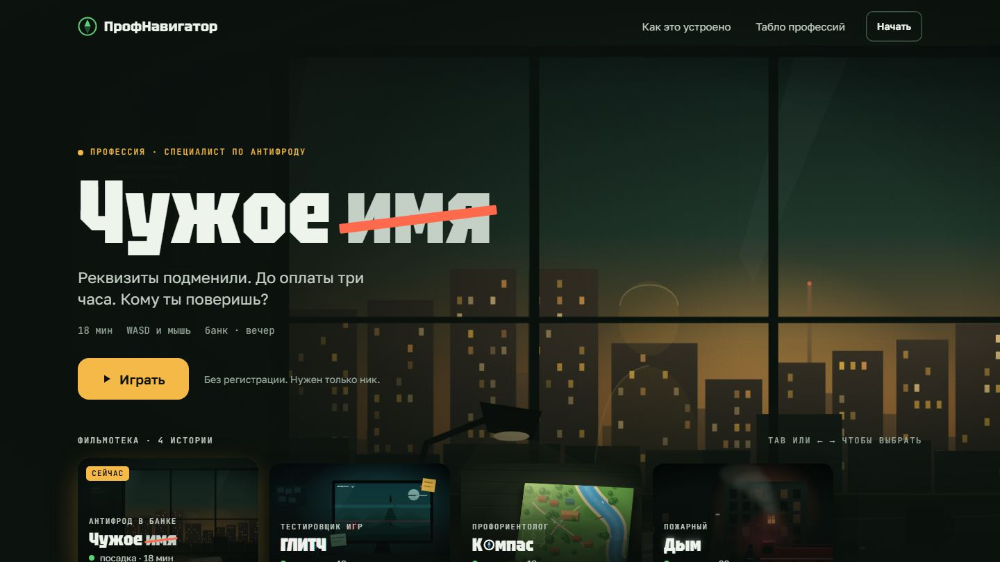
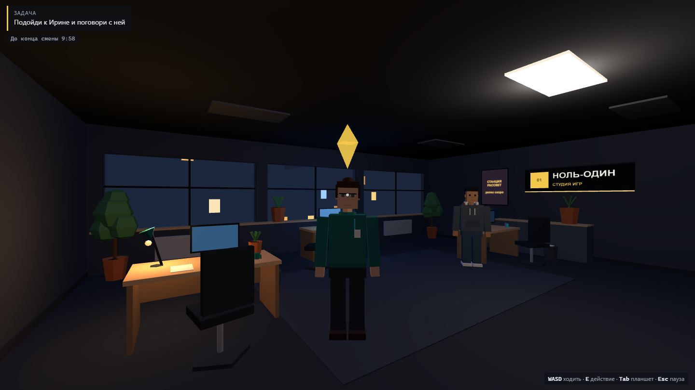
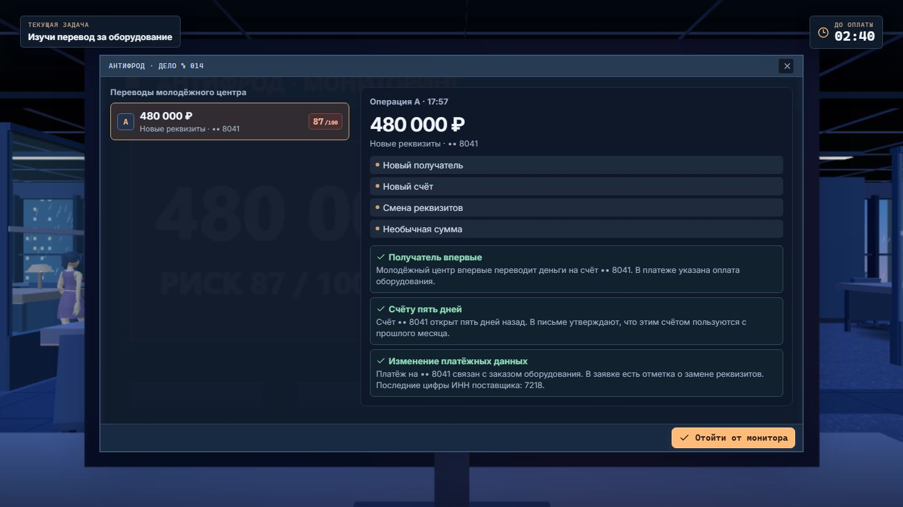
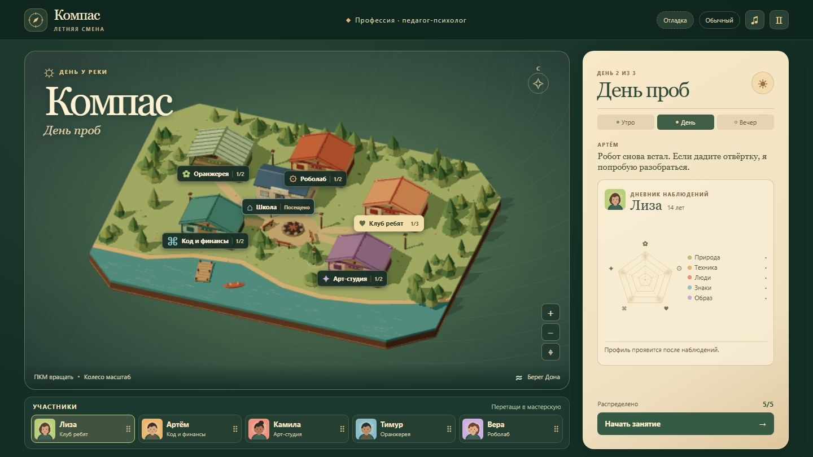
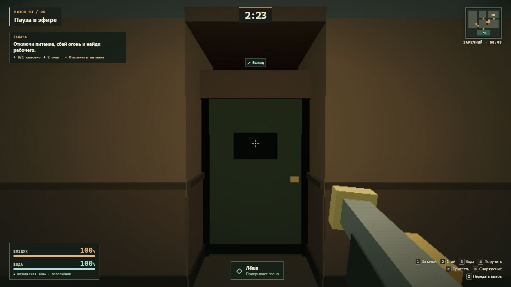
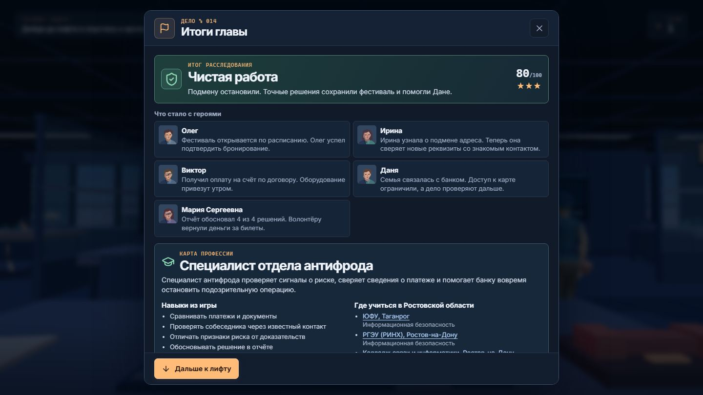
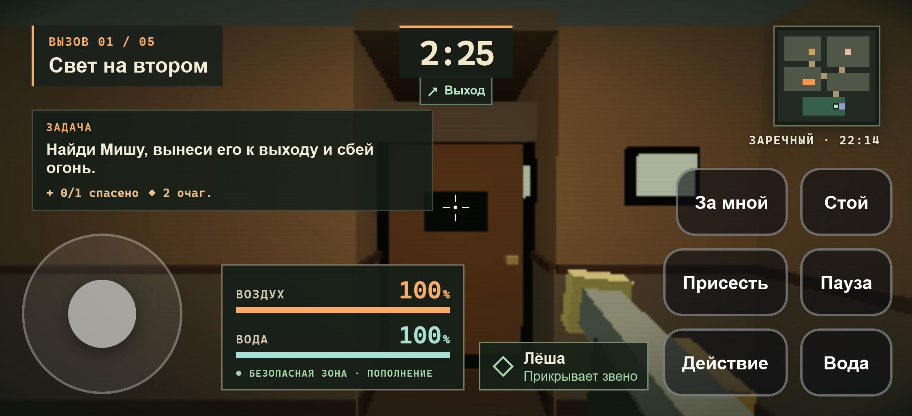
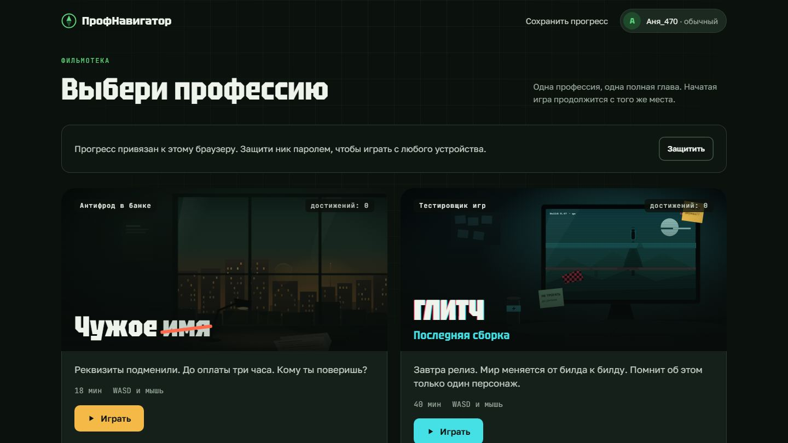
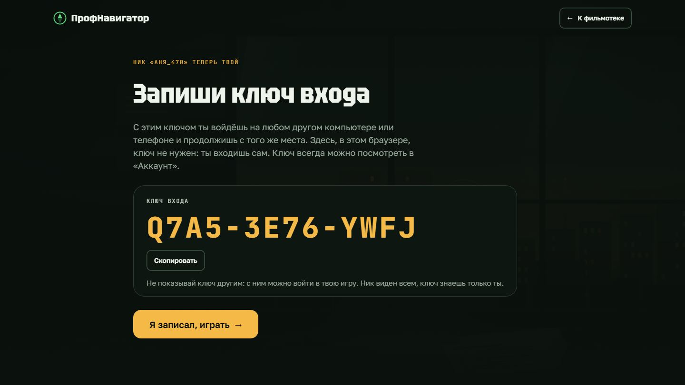

# ПрофНавигатор: сюжетные 3D-игры о профессиях

[](https://github.com/3xfap2/center-invest-case/actions/workflows/ci.yml)

**Играть:** ссылка появится после деплоя · без регистрации, нужен только ник · работает на компьютере, iPhone и Android

Кейс банка «Центр-инвест» «ПрофНавигатор: выбери профессию будущего», Cyber Garden School 2026.

Подросток до 16 лет выбирает профессию, но мало знает о ней. Мы сделали платформу, где профессию можно **прожить**: каждая игра это полная сюжетная глава с героями, выбором и последствиями, а в финале карточка профессии с реальными фактами и местами учёбы в Ростовской области.

- **Четыре игры, четыре профессии, четыре разные механики:** тестировщик игр, специалист антифрода в банке, школьный профконсультант, пожарный.
- **Без регистрации:** уникальный ник и ключ входа, который система выдаёт сама. По ключу прогресс открывается на другом устройстве.
- **Сохранение прогресса и три уровня сложности** (задачи со звёздочкой) в каждой игре.
- **Браузер на компьютере и телефоне:** на iPhone и Android появляются джойстик и кнопки.
- **Достижения и таблицы лидеров**, сервер на Go, около 245 автотестов, CI на каждое изменение.

[](docs/img/landing.jpg)

| ГЛИТЧ: тестировщик в игровой студии | Чужое имя: антифрод-терминал банка |
|---|---|
| [](docs/img/glitch.jpg) | [](docs/img/chuzhoe-terminal.jpg) |
| **Компас: летний лагерь, 3D-диорама** | **Дым: ночной вызов, воздух и вода** |
| [](docs/img/kompas.jpg) | [](docs/img/dym.jpg) |
| **Финал главы: что стало с героями и карточка профессии** | **На телефоне: джойстик и кнопки** |
| [](docs/img/chuzhoe-ending.jpg) | [](docs/img/phone-dym.jpg) |
| **Каталог игр** | **Ключ входа для другого устройства** |
| [](docs/img/games.jpg) | [](docs/img/login-key.jpg) |

---

## Требования кейса: где смотреть

| Требование | Где сделано |
|---|---|
| Браузерная игра, полноценная сессия | сайт [web/](web/) открывает каждую игру во весь экран; сессия от старта до финала главы |
| Без регистрации, допускается ник | ник проверяется на уникальность на лету, никаких почт и телефонов: [web/src/ui/Start.tsx](web/src/ui/Start.tsx), `POST /api/v1/players` ([server/api.go](server/api.go)) |
| Завершённая часть геймплея (уровень или глава) | в каждой игре полная глава с несколькими финалами; в ГЛИТЧ четыре главы |
| Концепция, связанные персонажи, сюжет | раздел [«Игры»](#игры); сюжетные документы: [docs/GDD-chuzhoe-imya.md](docs/GDD-chuzhoe-imya.md), [games/glitch/docs/STORY_BIBLE.md](games/glitch/docs/STORY_BIBLE.md) |
| Нет критических багов | раздел [«Тестирование»](#тестирование): около 245 автотестов, CI на каждый pull request |
| Масштабируемость | новая профессия = новая папка игры по [контракту](docs/GAME_CONTRACT.md); сюжет в данных (вызовы «Дыма», лагерь «Компаса»); раздел [«Как добавить профессию»](#как-добавить-профессию) |
| Уникальные механики | у каждой игры своя: сравнение сборок мира, доска улик и звонки, наблюдение за подростками, раунды с запасом воздуха |
| ★ Сохранение прогресса | в браузере сразу, на сервере при доступности; вход на другом устройстве по ключу: [web/src/api/sync.ts](web/src/api/sync.ts) |
| ★ Несколько уровней сложности | «Лёгкий», «Обычный», «Сложный» выбираются на сайте и передаются в игру |
| Игра даёт представление о профессии | карточка профессии в финале с источниками: [docs/CAREERS.md](docs/CAREERS.md) |

---

## Игры

| | Профессия | Вид и управление | Длина | Механика |
|---|---|---|---|---|
| **ГЛИТЧ: Последняя сборка** | тестировщик игр (QA) | 3D от первого лица; WASD и мышь или касания | 4 главы, около 40 мин | воспроизвести баг по шагам, написать отчёт, переключать сборки мира и искать, где появилась ошибка |
| **Чужое имя** | специалист антифрода в банке | 3D от первого лица; WASD и мышь или касания | около 18 мин | звонки, терминал риска, улики против трёх часов до оплаты, решение и отчёт |
| **Компас** | педагог-психолог (профконсультант) | 3D-диорама сверху; мышь или касания | около 15 мин | распределить подростков по мастерским, наблюдать, задавать открытые вопросы, порекомендовать путь |
| **Дым** | пожарный-спасатель | 3D-экшен от первого лица; WASD и мышь или касания | около 20 мин | пять вызовов-раундов: снаряжение, воздух в баллоне, вода, напарник, спасение людей |

- **ГЛИТЧ.** Первый день в студии «Ноль-Один», завтра релиз игры «Станция Рассвет». Персонаж игры Лис помнит удалённые сборки, а предыдущий тестировщик оставил следы. Решение, сообщать ли о Лисе, меняет четвёртую главу. 36 достижений.
- **Чужое имя.** Стажёр антифрода. Фестивалю нужно оплатить 480 000 ₽ за три часа, реквизиты подменили через поддельное письмо, а 15-летний волонтёр Даня, «сдавший» карту, выглядит виновным, но он жертва. Четыре финала: «Чистая работа», «Перестраховка», «Деньги ушли», «Чужая вина».
- **Компас.** Три дня летнего лагеря на Дону, пять подростков со своими желаниями. Директор просит таблицу-рейтинг детей: отказаться от неё и есть профессиональный выбор. После финала игра строит профиль интересов самого игрока, как подсказку, а не приговор.
- **Дым.** Первая ночная смена в пожарной части № 3: пять вызовов, командир Саныч, напарник Лёша, диспетчер Ирина. Оружия нет: вместо него рукав, а часы это воздух в баллоне. Вода на горящее масло или проводку делает только хуже.

Каждый финал показывает, что стало с героями, и **карточку профессии**: чем занимается специалист, какие навыки игрок использовал, где учиться в Ростовской области (ЮФУ, РГЭУ (РИНХ), ДГТУ, Колледж связи и информатики) и ссылки на официальные источники (Банк России, МЧС России, профстандарт). Все ссылки проверены: [docs/CAREERS.md](docs/CAREERS.md).

---

## Быстрый запуск

Нужен Docker.

```bash
docker build -t profnav .
docker run -p 8080:8080 -v profnav-data:/data profnav
```

Откройте http://localhost:8080. Сайт, все четыре игры и API работают с одного адреса.

Без Docker (нужны Node.js 24 и Go 1.27):

```bash
cd web && npm ci && npm run build      # сайт в web/dist, игры уже собраны в web/public/games/
cd ../server && go run .               # http://localhost:8080
```

Режим разработки сайта: `cd web && npm run dev` (запросы `/api` уходят на `:8080`).

---

## Что посмотреть за 5 минут

1. **Главная.** Выберите игру на полке: меняются сцена, цвет и описание.
2. **Старт.** Введите ник: сайт сразу скажет, свободен ли он. После «Дальше» система выдаст **ключ входа** вида `K7MX-2QPA-9RTD`.
3. **Игра.** Откройте любую из четырёх. Прогресс сохраняется сам; закройте вкладку и вернитесь: игра продолжится с того же места.
4. **Финал главы.** Остаётесь в игре (в ГЛИТЧ можно сразу перейти ко второй главе), а «Итоги главы» показывают звёзды, достижения и таблицу лидеров.
5. **Другое устройство.** На телефоне откройте «Аккаунт», введите ключ: прогресс тот же.

---

## Как устроено

```
Браузер
├── Сайт (React, web/)                      игрок, сохранения, итоги, лидеры
│   ├── сохранения в браузере (Zustand + Zod)
│   ├── синхронизация с сервером /api/v1 (если он доступен)
│   └── /play/<игра>: <iframe src="/games/<игра>/index.html">
│                           │ postMessage, тот же домен, { ns: 1, type, … }
└── Игра (Three.js, games/<игра>/ → web/public/games/<игра>/)
        └── ns-bridge.js: ready · save · flag · progress · achievement · end · exit

Сервер (Go + SQLite, server/)   отдаёт сайт, игры и API с одного адреса
```

- **Почему iframe и мост.** Игры написаны разными людьми на своих стеках. В iframe каждая изолирована: ошибка одной игры не ломает сайт. Связь только через маленький мост сообщений: [docs/GAME_CONTRACT.md](docs/GAME_CONTRACT.md).
- **Проверка сообщений.** Сайт принимает сообщение, только если оно с нашего домена, из этого iframe, с `ns: 1` и проходит Zod-схему. Сохранение не больше 64 КБ; достижения только с префиксом своей игры (`gl_`, `ci_`, `km_`, `dm_`).
- **Сохранения.** Сначала в браузере, затем копия на сервере. Без сервера всё работает, статус говорит «Сохранено на этом устройстве».
- **Конец главы.** Сайт записывает результат, но игрок остаётся в игре: многоглавные игры продолжаются, а итоги открываются кнопкой или при выходе.

Подробно: [docs/DEFENSE.md](docs/DEFENSE.md) (короткие ответы на вопросы жюри), [docs/API.md](docs/API.md).

---

## Игроки, ник и ключ входа

- **Ник уникален** (регистр не важен, «ё» = «е»). Сайт проверяет его при вводе.
- **Ключ входа** генерирует сервер: 12 символов без похожих букв и цифр (нет 0/O, 1/I/L), около 2⁵⁹ вариантов. Ник виден всем в таблицах, ключ знает только игрок.
- **То же устройство:** входить не нужно, браузер помнит игрока после закрытия и перезагрузки.
- **Другое устройство:** «Войти» → ключ. Можно ввести строчными, с пробелами и русскими буквами-двойниками.
- **Пароль** по желанию: ник + пароль, хранится только bcrypt-хеш.

---

## Телефоны и планшеты

- Игры определяют устройство: iPhone и iPad (Safari и любые браузеры iOS), Android, другие сенсорные экраны, компьютер.
- На телефоне появляются **джойстик и кнопки** («Действие», «Задачи», «Вода», «Присесть», «Пауза»), взгляд по движению пальца. В «Компасе» камера поворачивается пальцем, а всё помещается на один экран.
- На Android игра переходит во весь экран и в горизонтальный режим после первого касания; на iPhone занимает всю страницу. Вертикально игра просит повернуть телефон.
- На компьютере ничего не меняется.

---

## Тестирование

| Часть | Тесты |
|---|---|
| Сайт ([web/](web/)) | 57 юнит-тестов (Vitest): сообщения моста, сохранения, синхронизация, аккаунты, ключи; 20 браузерных тестов (Playwright) на собранном сайте, включая тест, который запускает **все четыре игры** и проверяет мост и **ноль ошибок в консоли** |
| Сервер ([server/](server/)) | 92 теста Go с `-race`: каждый метод API, ошибки ввода, лимиты запросов, ключи, обновление старой базы; около 78 % строк |
| ГЛИТЧ | около 25 проверок: контракт, автопрохождение всех глав на ПК и телефоне, режим iframe, собранная версия |
| Чужое имя | 26 юнит-тестов и браузерный тест через все финалы |
| Компас | 15 юнит-тестов и браузерный тест |
| Дым | 19 юнит-тестов и браузерный тест |

Каждый pull request проходит CI ([.github/workflows/ci.yml](.github/workflows/ci.yml)): юнит- и браузерные тесты сайта, `go vet`, `gofmt`, `go test -race`. Отдельно проверено на профилях iPhone 13 (WebKit) и Pixel 7 (Chromium).

Запуск локально:

```bash
cd web && npm test && npm run e2e
cd server && go test -race ./...
cd games/<игра> && npm test
```

---

## API

Сервер на Go без фреймворков (`net/http`) и SQLite без CGO. Полное описание: [docs/API.md](docs/API.md).

| Метод | Путь | Что делает |
|---|---|---|
| POST | `/api/v1/players` | занять ник, получить токен и ключ входа |
| GET | `/api/v1/players/check` | свободен ли ник |
| POST | `/api/v1/login/key` | войти по ключу |
| GET, PUT | `/api/v1/saves/{gameId}` | сохранение игры |
| POST | `/api/v1/runs` | результат главы |
| POST | `/api/v1/achievements` | достижения |
| GET | `/api/v1/leaderboard`, `/api/v1/leaderboard/achievements` | лидеры по очкам и по достижениям |
| GET | `/api/v1/stats` | какие финалы выбирают игроки |
| GET | `/api/v1/health` | проверка сервера |

Защита: проверка всех входных данных, лимит тела запроса, лимиты на IP (чтение, запись, вход), токены и ключи хранятся только как SHA-256, пароли как bcrypt, заголовки безопасности. В логах нет ников, токенов и IP.

### Переменные окружения

| Переменная | По умолчанию | Зачем |
|---|---|---|
| `PORT` | `8080` | порт сервера |
| `DB_PATH` | `data/profnav.db` (в Docker `/data/profnav.db`) | файл SQLite |
| `STATIC_DIR` | `../web/dist` (в Docker `/app/web`) | собранный сайт с играми |
| `TRUST_PROXY` | выключено | `1` за прокси (Render): лимиты по IP игрока |

---

## Персональные данные

Храним только **ник**, случайный идентификатор, хеши токенов и ключа, по желанию bcrypt-хеш пароля, сохранения и результаты. Нет почты, телефона, возраста, имени, IP в записях игроков. Это важно, потому что игроки младше 16 лет.

---

## Как добавить профессию

1. Новая папка `games/<id>/` со своей игрой на любом стеке, сборка в `web/public/games/<id>/index.html`.
2. Подключить общий мост `games/shared/ns-bridge.js` и выполнить [контракт](docs/GAME_CONTRACT.md): `ready` → `init` → `save` / `progress` / `achievement` → `end`.
3. Файл `games/<id>/game.json` с названием, профессией и длиной. Сайт найдёт игру сам и покажет её на полке; тест интеграции проверит её автоматически.

Сайт менять не нужно; на сервере только добавить `id` игры и префикс достижений в список ([server/validate.go](server/validate.go)).

---

## Деплой

Один Docker-образ: сайт, игры и сервер. Для бесплатного хостинга Render в репозитории есть [render.yaml](render.yaml); шаги в [docs/DEPLOY.md](docs/DEPLOY.md).

---

## Структура

```
docs/                контракт игр, API, ответы жюри, источники фактов, скриншоты
games/shared/        общий мост ns-bridge.js
games/glitch/        ГЛИТЧ: Последняя сборка
games/chuzhoe-imya/  Чужое имя
games/kompas/        Компас
games/dym/           Дым
web/                 сайт; web/public/games/<id>/ собранные игры
server/              сервер на Go
Dockerfile           один образ для всего
render.yaml          бесплатный деплой на Render
```

---

## Стек

| Часть | Технологии |
|---|---|
| Игры | Three.js, Vite; TypeScript и React (Чужое имя, Компас, Дым), JavaScript (ГЛИТЧ) |
| Сайт | React 19, TypeScript, Vite, Tailwind CSS 4, Zustand, Zod |
| Сервер | Go 1.27 (`net/http`, `log/slog`), SQLite (`modernc.org/sqlite`), bcrypt |
| Тесты и CI | Vitest, Playwright (Chromium и WebKit), `go test -race`, GitHub Actions |
| Запуск | Docker (distroless), Render |

---

## Референсы

- **GTA V, Red Dead Redemption 2, The Witcher 3, Cyberpunk 2077:** эксперт, разобравший нашу первую версию из мини-игр, назвал их примером того, что держит игрока: персонажи, ставки, выбор с последствиями. Поэтому каждая игра у нас это сюжетная глава с героями и несколькими финалами.
- **Firewatch:** настроение сайта: одна большая сцена на игру, свет и цвет рассказывают историю.
- **Counter-Strike (жанр):** структура «Дыма»: раунды, снаряжение перед вызовом, таймер, команды напарнику. Только вместо оружия рукав и запас воздуха.

---

## Команда

| | Роль |
|---|---|
| **Ярослав Самоходкин** | капитан; платформа (сайт и сервер), игры «Чужое имя», «Компас», «Дым», презентация |
| **Матвей Давыдов** | игра «ГЛИТЧ: Последняя сборка» |

---

## Чего мы не утверждаем

- Игры не заменяют профориентацию со специалистом: «Компас» прямо говорит, что его профиль это подсказка, а не приговор.
- Факты о профессиях взяты из официальных источников на 22 ноября 2026 года; правила и программы обучения могут меняться.
- Таблицы лидеров защищены от простых подделок (проверка значений, один лучший результат на игрока, лимиты), но игра работает в браузере игрока, поэтому настойчивый игрок может отправить правдоподобный ложный результат.
- Все люди, компании, банк и город в играх выдуманы.
